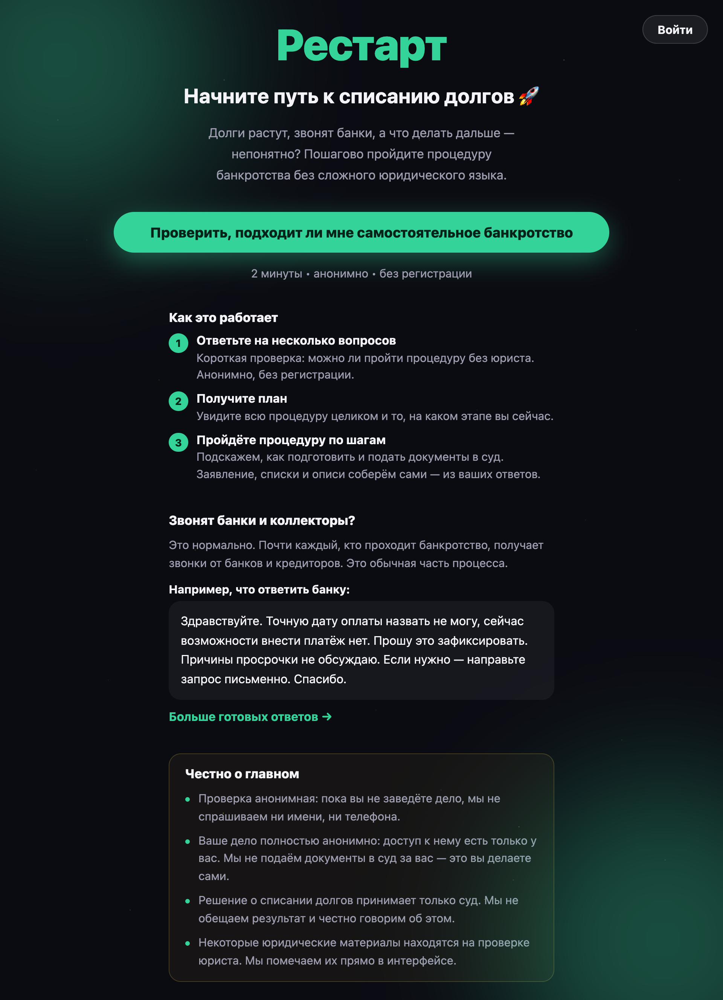
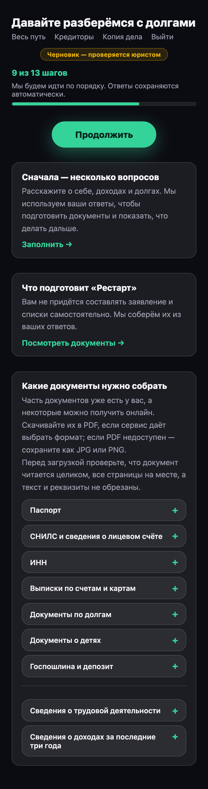
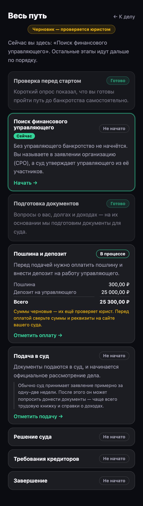
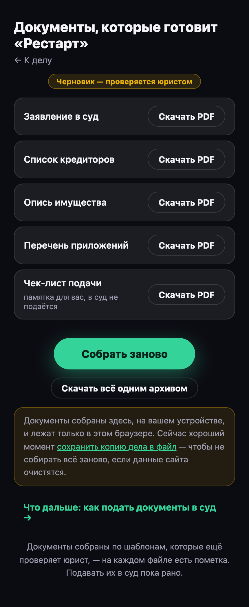

# Restart · «Рестарт»

A consumer app that walks a person through the Russian personal-bankruptcy procedure step by step —
plain language, one action per screen, no legal jargon. The product interface is Russian; the code
and the developer documentation are English.

> **All legal content is a placeholder pending lawyer review.** Every generated document carries a
> «ШАБЛОН-ПЛЕЙСХОЛДЕР — НЕ ПРЕДНАЗНАЧЕН ДЛЯ ПОДАЧИ В СУД» banner and the UI says the same. The app
> never promises that debts will be discharged, and it never files anything with a court on the
> user's behalf — the person does that themselves. Open questions:
> [docs/lawyer-review.md](docs/lawyer-review.md).

<p align="center">
  <a href="docs/screenshots/landing.png"></a><br>
  <em>The landing — one action: start the check.</em>
</p>

<table>
  <tr>
    <td align="center" valign="top" width="33%">
      <a href="docs/screenshots/journey.png"></a><br>
      <em>The case home — progress and the next step.</em>
    </td>
    <td align="center" valign="top" width="33%">
      <a href="docs/screenshots/procedure.png"></a><br>
      <em>«Весь путь» — the stages, the current one marked.</em>
    </td>
    <td align="center" valign="top" width="33%">
      <a href="docs/screenshots/documents.png"></a><br>
      <em>The filing package, built in the browser.</em>
    </td>
  </tr>
</table>

<sub>Screens from a made-up demo case; nothing in them belongs to a real person.</sub>

## What it does

| Screen | What happens |
|---|---|
| `/check` | A 2-minute screening: is a self-service bankruptcy realistic, or is this a case for a lawyer? Anonymous, no account, stores nothing. |
| `/pay` | «Откройте весь путь» — the one-off 1 000 ₽ payment through ЮKassa (Russian cards, СБП). Everything from `/journey` to `/backup` sits behind it; `/check` and `/calm` stay free. `/pay/return` is where ЮKassa sends the person back. |
| `/journey` | The case home — «Давайте разберёмся с долгами»: what is done, what to do next. |
| `/journey/:section` | The questionnaire: 21 sections (passport, registration, employment, income, family, creditors, accounts, property, payments, and the court case as it unfolds). `/journey/all` shows them all at once. |
| `/procedure` | «Весь путь» — the whole court procedure as 16 stages, several of them derived from the case rather than ticked by hand. |
| `/manager` | Choosing the organisation (СРО) the court will appoint the financial manager from. |
| `/documents` | The filing package — five documents rendered to PDF **in the browser** — plus a checklist of what is still missing before filing. |
| `/calm` | «Кредиторы» — what to say when a bank calls, letter templates, FAQ. The app's supportive corner. |
| `/backup` | «Копия дела» — one passphrase-encrypted `.restart` export file: the only way to move or recover a case. |

## Local-first: the case never leaves the device

Since 2026-08-15 ([docs/local-first-plan.md](docs/local-first-plan.md), phases 0–4) nothing the
debtor types is sent anywhere. Answers, journey progress and the generated PDFs live in **IndexedDB**;
the engine that produces them — validation, model assembly, the Mustache renderer, the PDF writer,
the derived stages, fees and deadlines — is `frontend/src/local/`.

What is left server-side is deliberately small:

- **`eligibility`** — the screening check. Stateless, anonymous, persists nothing.
- **`auth`** — accounts and stateless JWT, and nothing more. No case hangs off an account, so
  signing in on a second device shows an empty app, and the copy says so.
- **`payment`** — the one-off payment that opens the journey, through ЮKassa. It stores who paid
  how much and when, never anything about the case. Switched off (`PAYMENT_ENABLED=false`, the
  default) every signed-in account has access.

Two consequences worth knowing before touching anything:

- **Browser storage is evictable, and there is no server copy.** The encrypted export is the
  recovery story, not a nicety; clearing site data loses the case.
- **Keys are permanent.** Section keys index the answers already saved on someone's device and
  document types name the files stored beside them. There is no migration to run on a user's
  browser — adding is safe, renaming is not.

## The rules are content, not code

The questionnaire, the stages, the fees, the courts, the claim deadline and the text of the
documents themselves live in [`rules/`](rules/README.md) as YAML and versioned Mustache templates.
A legislative amendment or a lawyer's rewording is an edit to those files plus `npm run rules` —
no Java, no TypeScript.

`frontend/scripts/generate-rules.mjs` compiles them into `frontend/src/generated/` (committed,
because the frontend image only copies `frontend/`) and is also the only thing that validates them:
field types, duplicate keys, `uniqueBy` targets, quoted fee amounts, every partial a template pulls
in. CI runs `npm run rules:check` and fails on any drift. **Edit the YAML, never `src/generated/`.**

## Stack

- **Backend** — Spring Boot 4.1 / Java 21 modular monolith (Spring Modulith), MySQL 8.4, Flyway
  (V1–V13; `user_account`, `password_reset_token` and `payment`), stateless JWT, springdoc-openapi.
  Tested with JUnit, Testcontainers and ArchUnit.
- **Frontend** — React 19 + TypeScript + Vite SPA, React Router, IndexedDB, WebCrypto, `pdf-lib`
  (lazy-loaded on the documents screen only). Vitest + Testing Library.
- **Infrastructure** — Docker Compose for the local stack, nginx for the built SPA, GitHub Actions
  CI, Railway for deployment.

## Repository layout

```
src/main/java/ru/restart/app/   backend: auth, eligibility, common (api / application / domain / infrastructure)
src/main/resources/             application*.yml + Flyway migrations — nothing else
rules/                          questionnaire, journey, fees, courts, deadlines, document templates, font
frontend/src/local/             the case engine that runs in the browser
frontend/src/generated/         build product of rules/ — do not edit
frontend/src/pages/             the screens
docs/                           local-first plan, lawyer review dossier, Railway deploy, test traceability, screenshots
```

## Quick start

Full stack (MySQL + backend + frontend), everything health-checked:

```bash
cp .env.example .env
docker compose up --build
# frontend http://localhost:3000 · backend http://localhost:8080
docker compose --profile dev-tools up --build   # + Adminer on :8081
```

Frontend alone (the fast loop — Vite proxies `/api` to `:8080`):

```bash
cd frontend
npm ci
npm run dev            # http://localhost:3000
npm run rules          # regenerate src/generated/ after editing rules/
```

Backend alone, against a MySQL you provide:

```bash
./mvnw spring-boot:run
```

There is **no default Spring profile** — `local` (Swagger on) or `prod` (everything from env, fails
fast on a missing secret) must be chosen explicitly; `test` is what the integration tests use.
Swagger UI, `local` only: http://localhost:8080/swagger-ui.html

### API surface

`/api/v1/eligibility/check` · `/api/v1/auth/{register,login,refresh,forgot-password,reset-password,me}`
· `/api/v1/payments` (`GET /access`, `POST`, `GET /{id}`, and the public ЮKassa webhook
`POST /yookassa/notifications`)
— that is the whole of it.

## Tests

```bash
./mvnw clean verify                 # unit + Testcontainers integration + Modulith/ArchUnit
./mvnw test -Dtest=ModularityTest   # a single class
cd frontend && npm run lint && npm run build && npm test
```

CI runs both halves plus `npm run rules:check` on every PR, and fails the build if any test was
*skipped* — the Testcontainers tests must actually run for real, against MySQL. Running them on
Colima needs the Docker socket pointed at explicitly ([CLAUDE.md](CLAUDE.md)); which requirement
each test pins is mapped in [docs/testing.md](docs/testing.md).

## Deployment

Three Railway services — managed MySQL, backend (root `Dockerfile`), frontend
(`frontend/Dockerfile`), configured as code in `railway.json` / `frontend/railway.json`. Step by
step, including the variables: [docs/deploy-railway.md](docs/deploy-railway.md).

## Conventions

Architecture rules, the module layering, the copy and visual style, and the standing **no comments
in code** rule are in [CLAUDE.md](CLAUDE.md). The rule catalogue is in
[rules/README.md](rules/README.md).
